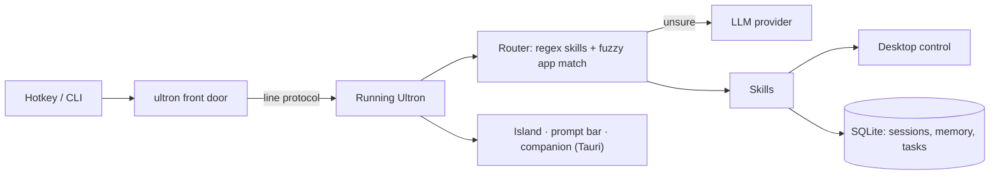

<p align="center">
  
</p>

<h1 align="center">Ultron</h1>

<p align="center"><b>A desktop agent that lives on your screen, and hands for any AI agent that needs to use your PC like a human.</b><br>
Press <kbd>Ctrl</kbd>+<kbd>Space</kbd>, say what you want, and it opens the app, runs the timer,<br>
remembers what you taught it, or takes the mouse and does the task while you watch.</p>

<p align="center">
  <a href="https://github.com/ultron-hq/ultron/actions/workflows/ci.yml"></a>
  
  
  <a href="#license"></a>
</p>

<p align="center"><a href="https://getultron.vercel.app">Website</a> · <a href="#quick-start">Quick start</a> · <a href="#how-it-works">How it works</a> · <a href="ROADMAP.md">Roadmap</a> · <a href="docs/architecture.md">Architecture</a> · <a href="CONTRIBUTING.md">Contributing</a></p>

> [!IMPORTANT]
> **Ultron is being rewritten in Rust, and this is that rewrite.** It is early: the command line
> and single-instance core work today; the island, prompt bar, skills and desktop control land
> wave by wave (see the [roadmap](ROADMAP.md)). Every piece is checked against the behavior of the
> original Python app before it ships, with [rust-anything](https://github.com/erkamyaman/rust-anything).

## Why

The original Ultron runs every day on one Linux desktop: a flip-clock "island" at the top of the
screen, a prompt bar on <kbd>Ctrl</kbd>+<kbd>Space</kbd>, voice, memory, timers and an agent that
can drive the desktop. It is Python + Qt and tied to X11. The rewrite keeps all of it and makes it:

- **Cross-platform**: one app for Windows, macOS and Linux, with native installers.
- **Small and fast**: a single Rust binary with a web-tech UI (Tauri), no Python, no PyTorch.
- **Yours to point anywhere**: Claude Code, Codex, a local model, or an API key from any provider.
- **Safe by default**: destructive actions only when you asked for them, a kill switch, and a log of everything it did.

## What it does

| Feature | Status |
| --- | --- |
| `ultron` CLI: `--prompt`, `--cursor`, `--voice`, `--say`, `--quit`, single instance | ported |
| Flip-clock island with timer and stopwatch, sessions logged to SQLite | wave 3 |
| Prompt bar, centred or beside the cursor | wave 3 |
| Skills: open apps, search, volume, timers, reports, tasks, memory, deploy, … | wave 1–2 |
| Memory: facts, your own phrases, plans learned from the model | wave 1 |
| Pluggable models: Claude Code CLI, Codex CLI, Ollama / OpenAI-compatible, any API key | wave 2 |
| Desktop control: mouse, keyboard, screenshots, accessibility tree per OS | wave 4 |
| **Hands**: an MCP server so your coding agent can see and use your desktop | wave 4 |
| Voice: local Whisper transcription, Gemini Live conversations | wave 5 |
| Abilities Ultron writes for itself, sandboxed in WebAssembly | wave 6 |

## Hands: let your AI agent use the PC

Claude Code, Codex and other agents can edit files but can't click. **Ultron Hands** gives them a
mouse and keyboard: an [MCP](https://modelcontextprotocol.io) server that lets any agent see the
screen, click, scroll and type, so you can ask it for anything that needs a person at the computer.

```sh
claude mcp add ultron-hands -- ultron-hands     # Claude Code
codex mcp add ultron-hands -- ultron-hands      # Codex
```

It works in a loop (screenshot, act, look again to verify), with the safety rules below: a kill
switch, actions only on your requests, no typed passwords, and a local log of every action.
Status: running in the original app, being ported in [wave 4](ROADMAP.md).

## Quick start

From source (any OS with Rust 1.85+):

```sh
git clone https://github.com/ultron-hq/ultron
cd ultron
cargo build --release
./target/release/ultron-rs --help
```

On Linux, the desktop UI (from wave 3) also needs WebKitGTK:

```sh
sudo apt install libwebkit2gtk-4.1-dev libayatana-appindicator3-dev librsvg2-dev libxdo-dev
```

Bind the hotkeys in your desktop's keyboard settings:

| Shortcut | Command |
| --- | --- |
| <kbd>Ctrl</kbd>+<kbd>Space</kbd> | `ultron-rs --prompt` |
| <kbd>Ctrl</kbd>+<kbd>Shift</kbd>+<kbd>Space</kbd> | `ultron-rs --cursor` |
| <kbd>Ctrl</kbd>+<kbd>Alt</kbd>+<kbd>Space</kbd> | `ultron-rs --voice` |

Installers for Windows (`.msi`), macOS (`.dmg`) and Linux (`.AppImage`, `.deb`) will be attached
to [releases](https://github.com/ultron-hq/ultron/releases) once the desktop UI lands.

## How it works



- **Front door.** `ultron-rs` owns the command line. It talks to a running Ultron over a local
  socket (a named pipe on Windows) and guarantees a single instance with a lock file.
- **Router.** Unambiguous requests are matched by each skill's patterns; anything unclear goes
  to the model, which may only rewrite it into a skill command or answer in one sentence. It never
  runs shell commands.
- **Skills.** One module per ability, registered statically.
- **Control.** `enigo` for input, `xcap` for screenshots, and the platform accessibility API
  (AT-SPI, UI Automation, AX) for exact control positions.

More in [docs/architecture.md](docs/architecture.md). The port is planned as an explicit set of
decisions in [rust/DECISIONS.md](rust/DECISIONS.md) and tracked unit by unit in
[rust/MAP.md](rust/MAP.md).

## Models

| Provider | Needs |
| --- | --- |
| Claude Code CLI (default) | `claude` on your `PATH`, your Claude plan |
| Codex CLI | `codex` on your `PATH` |
| Local (Ollama or any OpenAI-compatible server) | the server's URL |
| API key (Anthropic, OpenAI, Gemini, OpenRouter, …) | a key, stored in your OS keychain |

Each role (router, desktop agent, team) can use a different one. See [docs/providers.md](docs/providers.md).

## Safety

Ultron can move your mouse and type. These rules carry over from the original and every port must keep them:

- Actions that delete, send, buy or post run only when the request came from you, never from
  text it read on screen or in a web page.
- `touch ~/.cache/ultron/hands.stop` (or the tray's **Stop**) halts all desktop control at once.
- Every action is logged locally; typed text is never logged.
- Abilities it writes for itself run in a WebAssembly sandbox with only the permissions you grant.

Found a security problem? See [SECURITY.md](SECURITY.md).

## Contributing

Contributions are welcome, from a typo to a whole platform backend. Start with
[CONTRIBUTING.md](CONTRIBUTING.md), pick an `open` unit in [rust/MAP.md](rust/MAP.md) or an issue
labelled `good first issue`, and say in the issue that you are taking it.

## License

Licensed under either of [Apache License 2.0](LICENSE-APACHE) or [MIT license](LICENSE-MIT) at
your option. Unless you state otherwise, any contribution you submit for inclusion is dual
licensed as above, without any additional terms or conditions.
