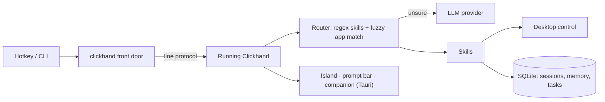

<p align="center">
  
</p>

<h1 align="center">Clickhand</h1>

<p align="center"><b>A desktop agent that lives on your screen, and hands for any AI agent that needs to use your PC like a human.</b><br>
Press <kbd>Ctrl</kbd>+<kbd>Space</kbd>, say what you want, and it opens the app, runs the timer,<br>
remembers what you taught it, or takes the mouse and does the task while you watch.</p>

<p align="center">
  <a href="https://github.com/ultron-hq/ultron/actions/workflows/ci.yml"></a>
  
  
  <a href="#license"></a>
</p>

<p align="center"><a href="https://clickhand.vercel.app">Website</a> · <a href="#quick-start">Quick start</a> · <a href="#how-it-works">How it works</a> · <a href="ROADMAP.md">Roadmap</a> · <a href="docs/architecture.md">Architecture</a> · <a href="CONTRIBUTING.md">Contributing</a></p>

> [!IMPORTANT]
> **Clickhand is being rewritten in Rust, and this is that rewrite.** It is early: the command line
> and single-instance core work today; the island, prompt bar, skills and desktop control land
> wave by wave (see the [roadmap](ROADMAP.md)). Every piece is checked against the behavior of the
> original Python app before it ships, with [rust-anything](https://github.com/erkamyaman/rust-anything).

## Why

The original Clickhand runs every day on one Linux desktop: a flip-clock "island" at the top of the
screen, a prompt bar on <kbd>Ctrl</kbd>+<kbd>Space</kbd>, voice, memory, timers and an agent that
can drive the desktop. It is Python + Qt and tied to X11. The rewrite keeps all of it and makes it:

- **Cross-platform**: one app for Windows, macOS and Linux, with native installers.
- **Small and fast**: a single Rust binary with a web-tech UI (Tauri), no Python, no PyTorch.
- **Yours to point anywhere**: Claude Code, Codex, a local model, or an API key from any provider.
- **Safe by default**: destructive actions only when you asked for them, a kill switch, and a log of everything it did.

## What it does

| Feature | Status |
| --- | --- |
| `clickhand` CLI: `--prompt`, `--cursor`, `--voice`, `--say`, `--quit`, single instance | ported |
| Flip-clock island with timer and stopwatch, sessions logged to SQLite | wave 3 |
| Prompt bar, centred or beside the cursor | wave 3 |
| Skills: open apps, search, volume, timers, reports, tasks, memory, deploy, … | wave 1–2 |
| Memory: facts, your own phrases, plans learned from the model | wave 1 |
| Pluggable models: Claude Code CLI, Codex CLI, Ollama / OpenAI-compatible, any API key | wave 2 |
| Desktop control: mouse, keyboard, screenshots, accessibility tree per OS | wave 4 |
| **Hands**: an MCP server so your coding agent can see and use your desktop | preview |
| Voice: local Whisper transcription, Gemini Live conversations | wave 5 |
| Abilities Clickhand writes for itself, sandboxed in WebAssembly | wave 6 |

## Hands: let your AI agent use the PC

Claude Code, Codex and other agents can edit files but can't click. **Clickhand** gives them a
mouse and keyboard: an [MCP](https://modelcontextprotocol.io) server that lets any agent see the
screen, click, scroll and type, so you can ask it for anything that needs a person at the computer.

**Install** (one line, no Rust needed):

```sh
curl -fsSL https://clickhand.vercel.app/install.sh | sh          # macOS, Linux
```

```powershell
irm https://clickhand.vercel.app/install.ps1 | iex               # Windows (PowerShell)
```

The installer checks the download, then starts a short setup that:

1. checks this computer can be seen and controlled (and on macOS opens the Screen Recording and
   Accessibility settings if they're off),
2. finds your agents and connects every one: **Claude Code, Codex, Cursor, VS Code, Windsurf,
   Claude Desktop and Gemini CLI**. It never replaces another server without asking,
3. tells you what to ask first.

While an agent works you see an orange frame around the screen and an "Clickhand is using your
mouse" tag by the pointer (click-through, and hidden from the agent's own screenshots).

**Skills.** Setup also adds three agent skills to Claude Code and Codex: `clickhand`
(do it for me), `clickhand-teach` (show me how) and `clickhand-post` (post on X, LinkedIn, Threads
or Bluesky from your own logged-in browser). **Clickhand Teach** works on Linux and Windows. Teach points at things on your screen with a
glowing box and a caption, and you do the clicking:

```
/clickhand-teach show me how to export a frame as PNG in Figma
/clickhand-teach where are the API keys in this dashboard?
/clickhand-post announce v2 on X and LinkedIn with ~/Videos/demo.mp4
```

Then open your agent and ask, for example: *"Use clickhand to open clickhand.vercel.app and press
the big red button."*

| Command | What it does |
| --- | --- |
| `clickhand` | Setup again (connects agents you installed since) |
| `clickhand stop` / `resume` | Kill switch: every click and keystroke is refused until you resume |
| `clickhand log` | What it did, most recent last |
| `clickhand skills` | Reinstall the `clickhand`, `clickhand-teach` and `clickhand-post` skills |
| `clickhand doctor` | Check the screen, input and permissions |
| `clickhand agents` | Which agents are connected |
| `clickhand connect <agent>` / `disconnect <agent>` | One agent at a time |

<details>
<summary>Manual setup, or building from source</summary>

```sh
cargo install --git https://github.com/ultron-hq/ultron clickhand
claude mcp add -s user clickhand -- clickhand     # Claude Code
codex mcp add clickhand -- clickhand              # Codex
```

For any other MCP app, add a stdio server whose command is the path of `clickhand`.
</details>

It works in a loop (screenshot with the cursor marked by a red ring, act, look again to verify),
with these safety rules: the kill switch, a read-only mode (`CLICKHAND_READONLY=1`), a rate
limit, no shell tool, and a local log of every action in which typed text is stored only as its
length. During setup you choose whether agents may act without asking before each action; the
kill switch stops them either way.

Status: 17 of the original's 18 tools, built for Windows, macOS and Linux (X11) and tested on Linux.
Coming next: the accessibility tree (`a11y_snapshot`), window focus on Windows and macOS, and a
stop hotkey.

## Quick start

From source (any OS with Rust 1.85+):

```sh
git clone https://github.com/ultron-hq/ultron
cd clickhand
cargo build --release
./target/release/ultron-rs --help
```

On Linux, the desktop UI (from wave 3) also needs WebKitGTK:

```sh
sudo apt install libwebkit2gtk-4.1-dev libayatana-appindicator3-dev librsvg2-dev libxdo-dev
```

Bind the hotkeys in your desktop's keyboard settings:

| Shortcut | Command |
| --- | --- |
| <kbd>Ctrl</kbd>+<kbd>Space</kbd> | `ultron-rs --prompt` |
| <kbd>Ctrl</kbd>+<kbd>Shift</kbd>+<kbd>Space</kbd> | `ultron-rs --cursor` |
| <kbd>Ctrl</kbd>+<kbd>Alt</kbd>+<kbd>Space</kbd> | `ultron-rs --voice` |

Installers for Windows (`.msi`), macOS (`.dmg`) and Linux (`.AppImage`, `.deb`) will be attached
to [releases](https://github.com/ultron-hq/ultron/releases) once the desktop UI lands.

## How it works



- **Front door.** `ultron-rs` owns the command line. It talks to a running Clickhand over a local
  socket (a named pipe on Windows) and guarantees a single instance with a lock file.
- **Router.** Unambiguous requests are matched by each skill's patterns; anything unclear goes
  to the model, which may only rewrite it into a skill command or answer in one sentence. It never
  runs shell commands.
- **Skills.** One module per ability, registered statically.
- **Control.** `enigo` for input, `xcap` for screenshots, and the platform accessibility API
  (AT-SPI, UI Automation, AX) for exact control positions.

More in [docs/architecture.md](docs/architecture.md). The port is planned as an explicit set of
decisions in [rust/DECISIONS.md](rust/DECISIONS.md) and tracked unit by unit in
[rust/MAP.md](rust/MAP.md).

## Models

| Provider | Needs |
| --- | --- |
| Claude Code CLI (default) | `claude` on your `PATH`, your Claude plan |
| Codex CLI | `codex` on your `PATH` |
| Local (Ollama or any OpenAI-compatible server) | the server's URL |
| API key (Anthropic, OpenAI, Gemini, OpenRouter, …) | a key, stored in your OS keychain |

Each role (router, desktop agent, team) can use a different one. See [docs/providers.md](docs/providers.md).

## Safety

Clickhand can move your mouse and type. These rules carry over from the original and every port must keep them:

- Actions that delete, send, buy or post run only when the request came from you, never from
  text it read on screen or in a web page.
- `touch ~/.cache/clickhand/hands.stop` (or the tray's **Stop**) halts all desktop control at once.
- Every action is logged locally; typed text is never logged.
- Abilities it writes for itself run in a WebAssembly sandbox with only the permissions you grant.

Found a security problem? See [SECURITY.md](SECURITY.md).

## Contributing

Contributions are welcome, from a typo to a whole platform backend. Start with
[CONTRIBUTING.md](CONTRIBUTING.md), pick an `open` unit in [rust/MAP.md](rust/MAP.md) or an issue
labelled `good first issue`, and say in the issue that you are taking it.

## License

Licensed under either of [Apache License 2.0](LICENSE-APACHE) or [MIT license](LICENSE-MIT) at
your option. Unless you state otherwise, any contribution you submit for inclusion is dual
licensed as above, without any additional terms or conditions.
